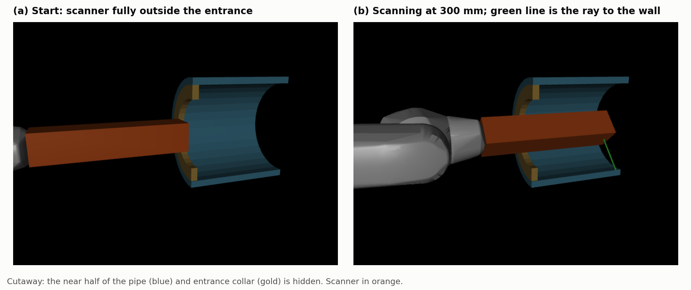
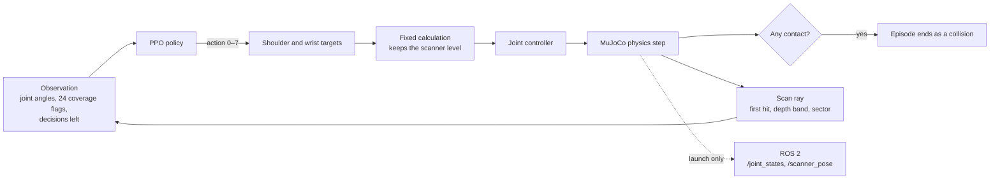
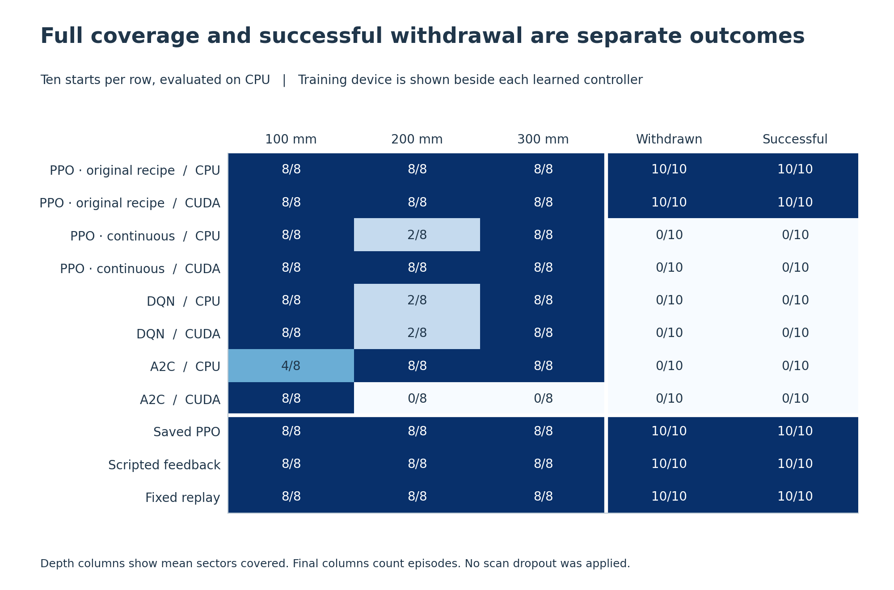
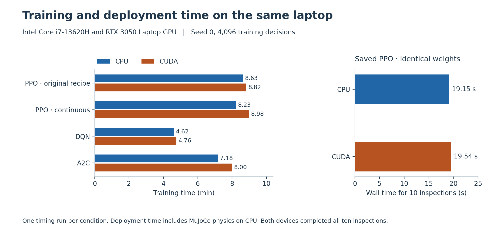
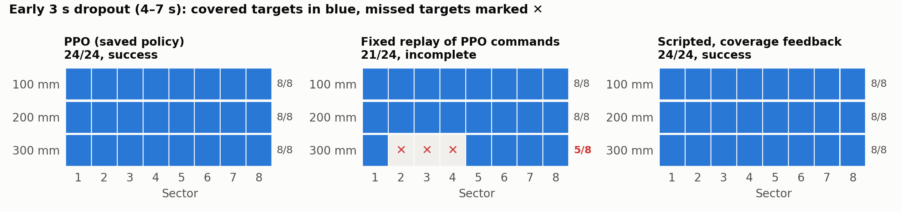
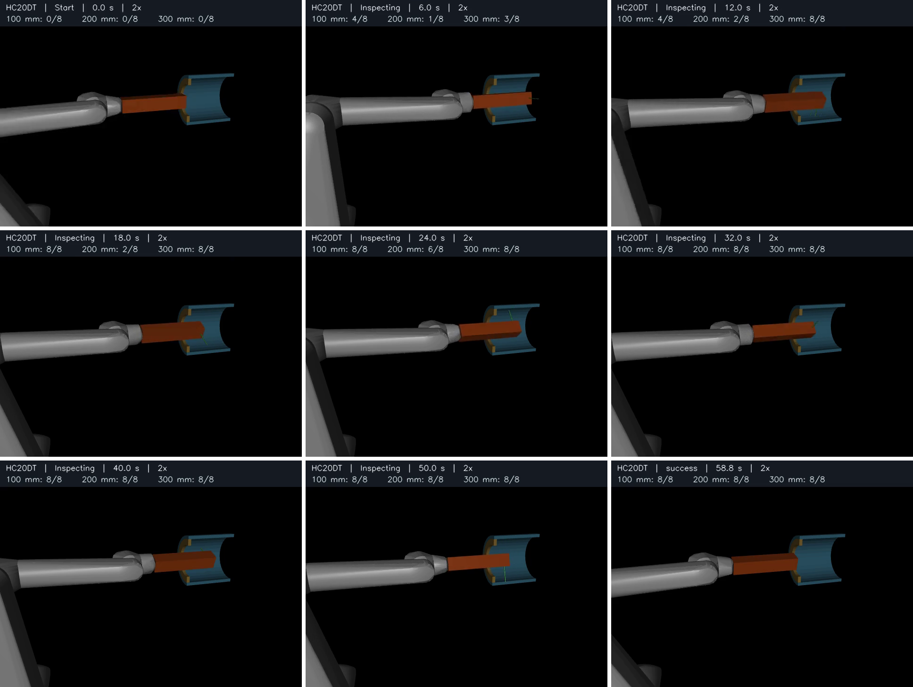

# HC20DT Pipe Inspection

This project uses ROS 2 Jazzy and MuJoCo to simulate a fixed-base Yaskawa Motoman HC20DT inspecting the inside of a pipe. A PPO policy chooses where the scanner goes next: it inserts the scanner through the entrance collar, scans the wall at 100, 200 and 300 mm, and withdraws it. MuJoCo checks for contact at every physics step. A ROS 2 launch file runs the saved policy and publishes the joint states and the scanner pose.

On the ten evaluation starts, the saved policy covered all 24 targets and withdrew fully with zero collisions every time. The technical report is in [report/REPORT.md](report/REPORT.md), with a PDF copy in [report/HC20DT_technical_report.pdf](report/HC20DT_technical_report.pdf).



## Quick start

After the [local setup](#local-setup), these three commands run the saved policy through ROS 2, evaluate it on the ten fixed starts, and train it again:

```bash
ros2 launch launch/inspection.launch.py
python -m evaluation.run
python -m training.pilot && python -m training.checkpoints
```

## Repository layout

| Folder | Contents |
|---|---|
| `assets/` | Supplied scanner, pipe and collar meshes |
| `simulation/` | Robot and scene model, coverage and contact checks, the RL environment and the ROS 2 node |
| `training/` | PPO pilot and checkpoints, seed study, algorithm and device comparison |
| `evaluation/` | The ten starts, evaluation scripts and per-episode results |
| `experiments/` | Standalone contact, ray and wrist checks, early path and dropout checks, and the six-joint stress test |
| `launch/` | ROS 2 launch file for the saved policy |
| `models/` | The saved policy |
| `demo/` | Recorded inspection video and live viewer |
| `report/` | Technical report, its figures, data and plotting scripts |

The `simulation/`, `training/`, `evaluation/`, `experiments/` and `report/` folders each have a short README that lists their files.

## Local setup

I ran the project on Ubuntu 24.04.5 LTS under WSL 2 with ROS 2 Jazzy already installed. The commands below use `git`, `colcon`, `xacro`, and the system Python with `venv` support.

### Create the Python environment

```bash
/usr/bin/python3 -m venv --system-site-packages ~/.venvs/hc20dt
source /opt/ros/jazzy/setup.bash
source ~/.venvs/hc20dt/bin/activate
python -m pip install -r requirements.txt
```

I used the system Python so the environment could load the ROS Python bindings. The demo and the figure scripts also need OpenCV, Matplotlib and Pillow. I used the Ubuntu packages (OpenCV 4.6.0, Matplotlib 3.6.3, Pillow 10.2.0), which the environment sees through `--system-site-packages`:

```bash
sudo apt install python3-opencv python3-matplotlib python3-pil
```

To check both imports in the same session, run

```bash
python -c "import os, rclpy, mujoco; print(os.environ['ROS_DISTRO'], mujoco.__version__)"
```

On my installation this printed `jazzy 4.0.1`.

### Build the Yaskawa model packages

I built Yaskawa's robot description in a separate ROS workspace. The checkout below uses the revision I tested.

```bash
source /opt/ros/jazzy/setup.bash
mkdir -p ~/hc20dt_ws/src
cd ~/hc20dt_ws/src

git clone --filter=blob:none --no-checkout https://github.com/Yaskawa-Global/motoman_ros2_support_packages.git
cd motoman_ros2_support_packages
git sparse-checkout set motoman_hc20_support motoman_resources
git checkout --detach a77f186048bd3c35fc3bb5142f9d9270dbebe69f

cd ~/hc20dt_ws
colcon build --packages-select motoman_resources motoman_hc20_support
```

### Start a new terminal

Open a WSL terminal in the `HC20DT_Pipe_Inspection` repository root. Run these three lines once in that terminal before starting the simulation.

```bash
source /opt/ros/jazzy/setup.bash
source ~/hc20dt_ws/install/local_setup.bash
source ~/.venvs/hc20dt/bin/activate
```

To check that ROS can find the robot description, run

```bash
ros2 pkg prefix --share motoman_hc20_support
```

This should print the package's `share/motoman_hc20_support` directory under `~/hc20dt_ws/install`.

## Reference inspection

```bash
python -m simulation.reference
```

The scripted controller starts with the scanner fully outside the entrance, inserts it, sweeps the wrist at three depths, and withdraws through the intermediate depths. The script checks for contact at every physics step. It checks withdrawal using the full scanner body, including its orientation.

In the nominal run, MuJoCo reported zero contacts. The final output was

```text
Coverage at 100, 200, 300 mm: [8, 8, 8]
Fully withdrawn: True
```

This run provides a baseline for evaluating a learned policy. The controller applies joint torques directly in MuJoCo without hardware torque limits.

## HC20DT model in RViz

To view the robot and move its six joints with sliders, run

```bash
ros2 launch motoman_hc20_support view_hc20dt.launch.xml
```

I checked the expanded URDF before mounting the scanner. It has six revolute joints. The fixed `flange` frame is 200 mm along the positive X axis of `link_6`. The robot description already includes this offset.

## Scanner mount in MuJoCo

```bash
python simulation/robot.py
```

At zero joint angles, the emitter was 475 mm forward and 50 mm above the flange. After I rotated `joint_6` by +90°, the ray pointed along +Y in the robot base frame. The script checks the emitter position and ray direction at both poses.

The scanner hangs from the `flange` through a fixed joint, so MuJoCo treats the two as one rigid body and does not test them against each other. This covers the tool mount without an explicit exclusion. I excluded contact between `base_link` and `link_1` because their collision meshes overlap at the first joint. The zero pose then had no contacts. With `joint_2` at −60° and `joint_3` at 240°, MuJoCo detected contact between `base_link` and `link_5`.

## Pipe scene and contact checks

```bash
python -m simulation.scene
```

I placed the entrance centre at `(1.255, 0, 1.200)` m in `base_link`, with the pipe axis pointing along +X. At zero joint angles the emitter is at x = 1.555 m, which puts it 300 mm inside the pipe. The pipe and collar dimensions follow the supplied geometry. Each ring uses the supplied STL mesh for rendering only. Contact checks and the scan ray use 32 boxes per ring, sized from the same inner and outer radii, because MuJoCo would otherwise fill the bore with the mesh's convex hull.

The scanner tip started 24.9 mm outside the entrance. MuJoCo reported zero contacts at the 101 sampled insertion poses, and the emitter reached the 100, 200 and 300 mm depth bands.

I checked two deliberate collisions. Turning `joint_1` by +4° from the final insertion pose brought the scanner into contact with the entrance collar. In a separate pose, with `joint_3` at −2° and `joint_5` at +15° and the other joints at zero, the scanner contacted the pipe wall 268.2–296.7 mm past the entrance. There was no collar contact in that pose.

## Scan coverage

```bash
python -m simulation.coverage
```

A target is one of eight 45° sectors in a depth band centred at 100, 200 or 300 mm. The depth tolerance is ±10 mm. A scan counts when the ray's first hit is the inner pipe wall and its range is between 75 and 175 mm, inclusive. The ray test excludes the scanner body. Sector numbering starts at +Z and follows the right-hand rule around +X.

I checked the centre of every sector at each depth. All 24 static poses returned the expected target without contact. Scanning the last pose a second time kept the count at 24.

## Ray occlusion experiment

```bash
ros2 launch experiments/ray_occlusion.launch.py
```

With the obstacle in the ray's path, the first hit was the obstacle at 100 mm. Moving it 30 mm sideways exposed the wall at 125 mm.

## Other checks

```bash
python experiments/collar_contact.py
python -m experiments.wrist_action
```

The first script checks the segmented collar and pipe wall against hand-calculated contact heights in a stripped-down scene. Its cases and results are in [experiments/collar_contact.md](experiments/collar_contact.md). The second moves the wrist by ±22.5° at the 300 mm band and checks that the ray lands in sectors 1 and 8 without contact.

The next three scripts are the first checks I ran on the trained policy. Each prints its results to the terminal.

```bash
python -m experiments.compare_inspection_paths
python -m experiments.check_dropout_official_starts
python -m experiments.check_coverage_exit
```

The first compares the saved policy with the scripted path, a shorter scripted path and random actions on the ten starts. The second withholds scan hits during the second decision, for the policy and for a replay of its nominal actions. The third withdraws as soon as all 24 targets are covered, with and without that lost decision. These results led to the fixed dropout scenarios in `evaluation/dropout.py` and the staged withdrawal described below.

## Train the policy

### What the policy controls

At each decision, the policy picks one of eight commands. Each command sets a shoulder target, which sets the scan depth, and a wrist target, which sweeps the ray around the pipe. A fixed calculation sets the other joints so the scanner stays level, and a joint controller moves the arm to the commanded pose.



The policy makes one decision per move. The controller, contact check and ray test run at every physics step until the move settles.

| Shoulder target | Tool position | Wrist −165° | Wrist +165° |
|---|---|---|---|
| −25° | Withdraw | 0 | 1 |
| −14° | 100 mm band | 2 | 3 |
| −7° | 200 mm band | 4 | 5 |
| 0° | 300 mm band | 6 | 7 |

Moving between the two wrist targets turns the ray through 330°. The 30° gap is smaller than one 45° sector, so one wrist move crosses all eight sectors.

- **Observation (31 values):** the six joint angles divided by π, 24 flags for the targets already seen, and the fraction of the 16 decisions left.
- **Reward:** +1 for each new target. +25 at the end of a successful episode and −25 at any other ending.
- **End of an episode:** a withdrawal command once the move settles, any contact, a move that does not settle within 12 simulated seconds, or all 16 decisions used.
- **Algorithm:** PPO from Stable-Baselines3 with an MLP policy, 64 decisions per rollout, batches of 32, discount factor 1 and seed 0. Evaluation uses the most probable action.

### PPO pilot

```bash
python -m training.pilot
```

I trained PPO on CPU for 128 decisions with seed 0. Training took 11.0 s, excluding validation.

Before training, the deterministic policy withdrew with zero coverage on all five validation starts. After reloading the trained policy, coverage was [4, 1, 0] at 100, 200 and 300 mm on all five starts. Each episode reached the 16-decision limit. On the nominal start, the policy kept requesting the same wrist position at 200 mm after its second decision.

### Checkpoints

```bash
python -m training.checkpoints
```

This loads the pilot and continues training to 1,024, 2,048 and 4,096 decisions, checking each checkpoint on the five validation starts. Coverage on those starts was [4, 0, 0] at 1,024, [5, 2, 8] at 2,048 and [8, 8, 8] at 4,096. I selected the 4,096-decision checkpoint because it was the first to cover all 24 targets and withdraw without contact on all five validation starts.

Both commands save their models in `/tmp`. To use a new run instead of the submitted policy, copy `/tmp/hc20dt_ppo_4096.zip` to `models/hc20dt_ppo_4096.zip`.

## Seed study

To train PPO from scratch for seeds 0–4 without the pilot restart, run

```bash
python -m training.seed_study
```

Each seed trains continuously and is checked at 128, 1,024, 2,048, 4,096 and 8,192 decisions on the five validation starts and the ten official starts. The script writes `report/data/seed_results_rerun.csv`. The data behind Figure 3 of the [report](report/REPORT.md) are in `report/data/seed_results.csv`. One of five seeds passed at 4,096 decisions and three passed at 8,192. The uninterrupted seed-0 run did not pass at either budget, so the submitted policy depends on the two-stage run above.

The training times in `seed_results.csv` are about 2.4 times those of a single run on an idle CPU: 26.3 s against 10.8 s for the first 128 decisions of seed 0. Compare the pass and coverage columns rather than the times. All five seeds take several hours on CPU.

## Compare algorithms and devices

```bash
python -m training.compare_controllers --out ~/hc20dt_runs/compare
bash training/compare_devices.sh
```

The first command trains PPO, DQN and A2C for 4,096 decisions with seed 0 and evaluates them on the ten starts, next to the coverage-feedback script and the fixed replay. The output folder must not exist yet. The second command also repeats the two-stage PPO run and evaluates the saved policy, training and evaluating on both CPU and CUDA, so it needs a working CUDA setup in WSL. My results are in [evaluation/hardware_seed0_4096](evaluation/hardware_seed0_4096). Together they cover 200 evaluation episodes.

| Controller (seed 0, 4,096 decisions) | Trained on | Successes | All 24 targets | Training time |
|---|---|---|---|---|
| Two-stage PPO (submitted recipe) | CPU | 10 / 10 | 10 / 10 | 518 s (separate rerun; the submitted run took 461 s) |
| Two-stage PPO (submitted recipe) | CUDA | 10 / 10 | 10 / 10 | 529 s |
| Continuous PPO | CPU | 0 / 10 | 0 / 10 | 494 s |
| Continuous PPO | CUDA | 0 / 10 | 10 / 10 | 539 s |
| DQN | CPU | 0 / 10 | 0 / 10 | 277 s |
| DQN | CUDA | 0 / 10 | 0 / 10 | 286 s |
| A2C | CPU | 0 / 10 | 0 / 10 | 431 s |
| A2C | CUDA | 0 / 10 | 0 / 10 | 480 s |

None of the runs had a collision. Among the four training configurations, only two-stage PPO succeeded on all ten starts after training on either device. The CPU run chose the same nine actions as the submitted policy. The CUDA run found a shorter sequence (`3 3 6 3 4 3 0`) that took 42.57 s of simulated motion. Continuous PPO, DQN and A2C reached the decision limit without withdrawing. Continuous PPO trained on CUDA covered all 24 targets.



In one timing run per configuration, training took longer on CUDA for all four configurations.

At seed 0, two-stage PPO learned different action sequences on CPU and CUDA. The comparison did not isolate the cause. For each of the nine checkpoints, evaluating the same weights on CPU and CUDA gave identical actions, coverage and outcomes on all ten starts. The submitted checkpoint took 19.15 s on CPU and 19.54 s on CUDA for those ten runs.



## Hardware and training time

| Item | Value |
|---|---|
| CPU | Intel Core i7-13620H (10 cores, 16 threads) |
| RAM | 40 GB DDR5-4800 (32 GB + 8 GB); about 19 GB available to WSL 2 |
| GPU | NVIDIA GeForce RTX 3050 Laptop GPU, 6 GB (used only in the CPU and CUDA comparison; the submitted policy was trained on CPU) |
| Host OS | Windows 11 Enterprise, build 26300 |
| Linux environment | Ubuntu 24.04.5 LTS on WSL 2 (WSL 3.0.5, kernel 6.18.58.1) |
| ROS 2 | Jazzy |
| Python | 3.12.3 |
| Key libraries | MuJoCo 4.0.1, Gymnasium 1.2.2, Stable-Baselines3 2.7.1, PyTorch 2.15.0, NumPy 1.26.4 |

| Training stage | Decisions | Wall time (CPU) |
|---|---|---|
| Pilot | 0 → 128 | 11.0 s |
| Checkpoint 1 | 128 → 1,024 | 84.7 s |
| Checkpoint 2 | 1,024 → 2,048 | 104.7 s |
| Checkpoint 3 | 2,048 → 4,096 | 260.6 s |
| **Total** | **0 → 4,096** | **461.0 s (7 min 41 s)** |

The pilot is `python -m training.pilot`. The three checkpoint stages come from one run of `python -m training.checkpoints`. Times exclude validation episodes. PPO was configured with `device="cpu"`.
The selected policy is `models/hc20dt_ppo_4096.zip`.

## Run the saved policy with ROS 2

From the repository root, activate the project environment as described above and run:

```bash
ros2 launch launch/inspection.launch.py
```

The launch runs the saved PPO policy from the nominal start. During the
inspection, `/joint_states` publishes all six joint positions and velocities,
and `/scanner_pose` publishes the scanner body's pose in `base_link`.
The final log line reports the episode outcome and the number of targets covered.

## Evaluate the saved policy

From the repository root, with the project environment active, run

```bash
python -m evaluation.run
```

The script loads the saved policy, reads the ten starts in [evaluation/starts.csv](evaluation/starts.csv), and writes one row per episode to [evaluation/results.csv](evaluation/results.csv).

The first start is the nominal pose. The other nine change `joint_1` and `joint_2` by −1° to +1°. I split each range into thirds and drew one offset pair from each of the nine cells with random seed 1. The starts were fixed before I evaluated the saved policy. An episode succeeds if it scans at least 20 of 24 targets, with at least six at each depth, then fully withdraws with zero collisions.

| Run | joint_1 offset (°) | joint_2 offset (°) | Targets at 100 / 200 / 300 mm | Collision | Withdrawn | Result |
|---|---|---|---|---|---|---|
| 1 | 0.000 | 0.000 | 8 / 8 / 8 | No | Yes | Success |
| 2 | −0.659 | −0.366 | 8 / 8 / 8 | No | Yes | Success |
| 3 | −0.904 | 0.299 | 8 / 8 / 8 | No | Yes | Success |
| 4 | −0.792 | 0.616 | 8 / 8 / 8 | No | Yes | Success |
| 5 | 0.218 | −0.727 | 8 / 8 / 8 | No | Yes | Success |
| 6 | 0.033 | −0.315 | 8 / 8 / 8 | No | Yes | Success |
| 7 | 0.169 | 0.692 | 8 / 8 / 8 | No | Yes | Success |
| 8 | 0.553 | −0.474 | 8 / 8 / 8 | No | Yes | Success |
| 9 | 0.535 | −0.031 | 8 / 8 / 8 | No | Yes | Success |
| 10 | 0.423 | 0.602 | 8 / 8 / 8 | No | Yes | Success |

The success rate was 10/10. There was no recurring failure on these starts. The policy chose the same nine actions from every start (`2 7 2 5 2 5 2 5 1`). The joint controller absorbed the start offsets, so these runs mainly test the controller. The policy had all 24 targets after its fourth action. It then revisited the 100 and 200 mm bands before withdrawing, because the reward does not penalise extra moves.

### Missing scan readings

```bash
python -m evaluation.dropout > evaluation/dropout_results.csv
```

This runs the same ten starts under the seven scan conditions in [evaluation/dropout_scenarios.csv](evaluation/dropout_scenarios.csv), including normal readings. During a dropout the robot keeps moving, but valid hits are not added to the coverage flags. Each method runs 70 episodes.

| Method | Mission success | All 24 targets |
|---|---|---|
| Saved PPO | 70 / 70 | 60 / 70 |
| Fixed replay of the nominal PPO actions | 60 / 70 | 50 / 70 |
| Script with coverage feedback | 70 / 70 | 70 / 70 |
| PPO with a fixed withdrawal after 24 targets | 70 / 70 | 60 / 70 |



Only the three-second dropout early in the scan changed a policy decision. The fourth action went to the 300 mm band instead of 200 mm, and the policy still covered all 24 targets. The fixed replay missed sectors 2, 3 and 4 at 300 mm and failed. The scripted controller with coverage feedback also succeeded on every run and took about half the simulated time.

### Starts with offsets on all six joints

```bash
python -m experiments.check_six_joint_starts | tee evaluation/six_joint_starts_results.txt
```

This draws 20 valid starts for each offset limit, with every joint offset at random. A start is valid when the scanner is fully outside the entrance and free of contact.

| Offset limit | Successes |
|---|---|
| ±1° | 20 / 20 |
| ±2° | 17 / 20 |
| ±3° | 12 / 20 |

All 11 failures were contacts between the scanner and the entrance collar during the first move, before any target was recorded. Ten touched the upper part of the collar, within 45° of +Z, and each of these had a positive `joint_3` offset. The one lower contact came from a negative `joint_3` offset. The scanner tip starts 24.9 mm from the collar, so a tilt left over from the start can reach the collar before the controller removes it.

## View the inspection

Watch the [recorded inspection](demo/inspection.mp4), or run the policy live in WSL with graphical application support:

```bash
MUJOCO_GL=egl python -m demo.live
```

The cutaway hides the near side of the rings so the scanner and its ray remain visible. The window shows coverage at each depth. Press Q or Esc to close it during the run.

To record a new video at twice the simulation speed, run

```bash
MUJOCO_GL=egl python -m demo.record_demo
```

Both commands use OpenCV and EGL. Recording also requires FFmpeg with the libx264 encoder (`sudo apt install ffmpeg`, or a Windows `ffmpeg.exe` on the path under WSL) and replaces `demo/inspection.mp4`.



The frames come from the recorded video, which plays at twice the simulation speed. The header shows simulation time and the sectors covered at each depth. All 24 targets are covered by 32 s. The remaining moves revisit the 100 and 200 mm bands, and the scanner is fully withdrawn at 58.8 s.

## Regenerate the report figures

```bash
MUJOCO_GL=egl python -m report.make_figures
python -m report.plot_benchmarks
python -m report.demo_frames
```

The first command reruns the saved policy to draw figures 1–5 from the committed results. The second draws figures 6–10 from the CSV and text results without running the simulation. The third takes nine frames from `demo/inspection.mp4` with FFmpeg. All three write to `report/figures/`.
