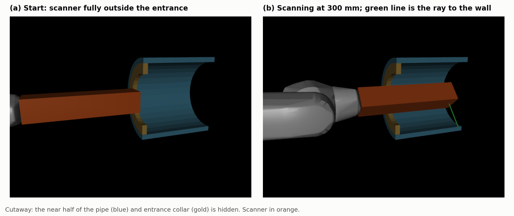
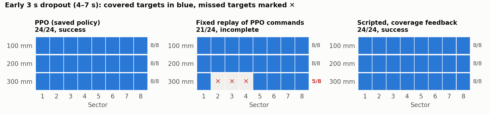
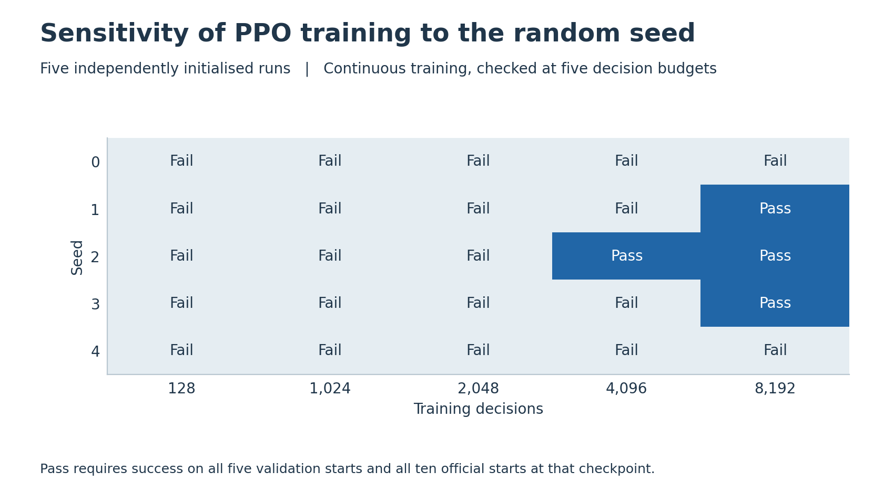
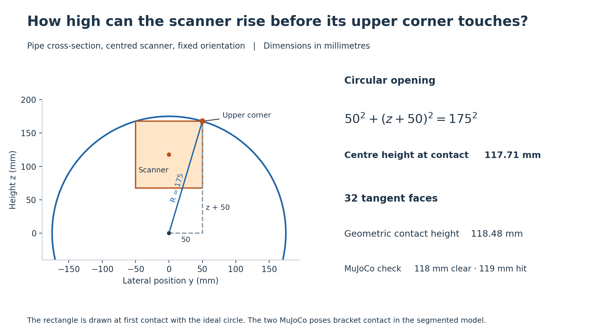
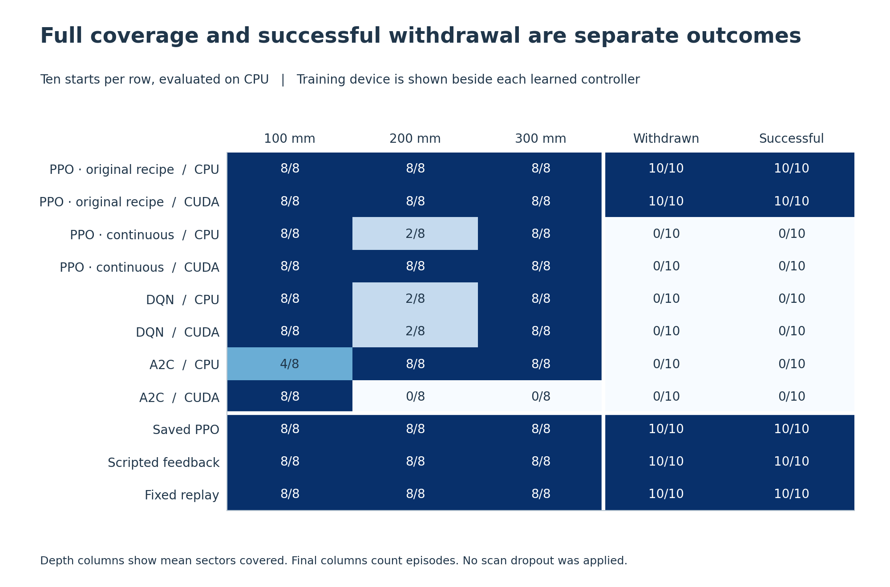
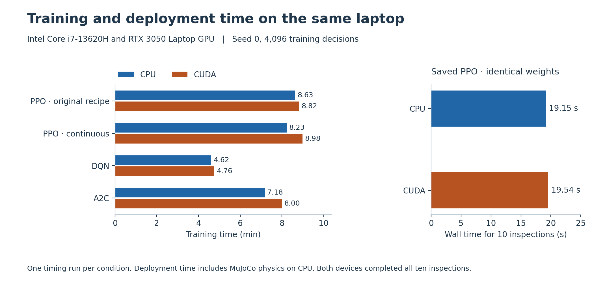
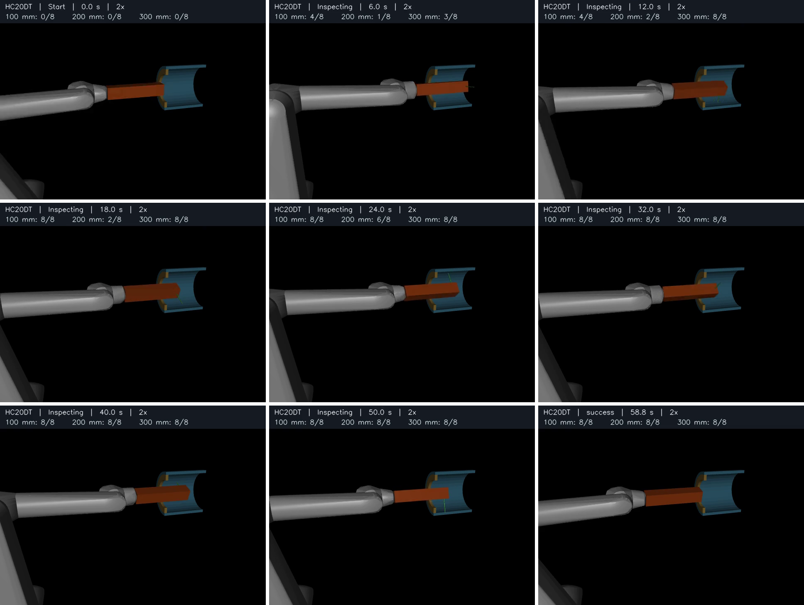

# Pipe inspection with the Yaskawa HC20DT

Taha Mohammadi · November 2026 · [github.com/tahamohamadi-ir/HC20DT_Pipe_Inspection](https://github.com/tahamohamadi-ir/HC20DT_Pipe_Inspection)

A fixed-base robot has to pass a scanner through a narrow collar, scan the pipe wall and pull the whole tool back out. The saved policy completed all ten evaluation runs. In each one it scanned all 24 targets and withdrew without contact. In a separate test, scan readings were withheld for three seconds. On its fourth move the policy chose a deeper pass and recovered three sectors that a fixed command sequence missed.

## The inspection task

The scanner is 500 mm long with a 100 × 100 mm cross-section and mounts on the robot flange. The emitter sits 475 mm along the tool and 50 mm above its centreline, and its ray points along the tool's local +Z axis. The entrance collar has a 250 mm opening. Behind it, the pipe has a 350 mm bore and is 400 mm long.

The pipe entrance is at (1.255, 0, 1.200) m in the robot base frame, with its axis along +X. With all joint angles at zero, the emitter reaches 300 mm into the pipe, so the deepest target is within reach.



*Figure 1. The scanner starts outside the collar (left). At the deepest band (right), the green ray points toward the inner wall. The cutaway exposes the tool. Contact checks still use the full ring.*

The targets lie at depths of 100, 200 and 300 mm, with a tolerance of ±10 mm. Each band has eight 45° sectors, numbered from +Z around +X by the right-hand rule. A sector counts once when the ray first hits the inner wall at a range of 75–175 mm. The ray test ignores the scanner itself. A run passes with at least 20 distinct targets, at least six per band, full withdrawal and zero collisions throughout.

## Run the saved model

With the ROS workspace and Python environment active, run the first command from the project root to start the saved policy. During the run, `/joint_states` carries the six joint positions and speeds, and `/scanner_pose` gives the scanner body pose in the base frame. The second command evaluates the saved model on the ten fixed starts.

```bash
ros2 launch launch/inspection.launch.py
python -m evaluation.run
```

Project files: [Setup](../README.md) · [Scene](../simulation/scene.py) · [Ray checks](../simulation/coverage.py) · [Demo](../demo/inspection.mp4)

## What the policy decides

At each decision, the policy chooses a shoulder target and a wrist target. The shoulder sets the scan depth, and turning the wrist sweeps the ray across the sectors, so one move can cover several targets. The numbers in the table are the action IDs used in the logs. Each wrist target stops 15° short of ±180°, so moving from one to the other turns the ray through 330°. The 30° left unswept is narrower than one 45° sector and straddles the boundary between sectors 4 and 5, so each of those sectors still gets 30° of sweep. With the tool level, one wrist move crosses all eight sectors. A target still counts only after a valid hit in its depth band.

| Shoulder target | Tool position | Wrist −165° | Wrist +165° |
|---|---|:---:|:---:|
| −25° | Withdraw | 0 | 1 |
| −14° | 100 mm band | 2 | 3 |
| −7° | 200 mm band | 4 | 5 |
| 0° | 300 mm band | 6 | 7 |

### From observation to motion

The policy receives 31 values: the six joint angles divided by π, 24 flags for the targets it has seen, and the fraction of the 16 decisions left. During evaluation it takes the most probable action. A fixed calculation sets the other joint targets to keep the scanner level. The joint controller then uses the position and speed errors, the mass matrix and the bias forces to move toward the commanded pose. MuJoCo checks for contact at every physics step, and valid ray hits update the coverage flags.

### The fourth move

From the nominal start, the first three actions were 2, 7 and 2. With normal readings, the fourth action was 5. In a second run, the simulator withheld valid hits from 4 to 7 seconds. The robot kept moving, but those hits did not reach its coverage flags. This time the policy chose action 7. Both actions turn the wrist toward +165°, but action 5 sends the scanner to the 200 mm band and action 7 sends it to 300 mm.

Replaying the original nine commands under the same interruption kept action 5. The scanner withdrew, but it missed sectors 2, 3 and 4 at the deepest band. The learned policy came back with all 24 targets. The change in the fourth command shows where scan feedback affected motion in this test.



*Figure 2. Each cell is one target. The fixed replay missed three sectors in the 300 mm band. Both the saved policy and a hand-written controller that checked coverage reached all 24 targets.*

Project files: [Observation and action IDs](../simulation/gym_env.py) · [Action execution](../simulation/inspection_env.py) · [Joint controller](../simulation/reference.py) · [Action logs](../evaluation/dropout_results.csv)

## Training and checkpoint selection

Proximal Policy Optimization (PPO) suits this task because it can learn a choice among eight commands from a small observation vector. It updates the action probabilities using recent runs, and its objective limits how far a single update can move the policy. A small feedforward network was enough for the fixed pipe layout. DQN and A2C also support these actions and were included in a separate comparison.

### Reward and stopping rules

Each new target earns one point. Success adds 25 points at the end and failure subtracts 25, so the final reward outweighs all 24 target points. A withdrawal command ends the episode once the move settles, and the environment then checks coverage and tool position. Contact, a move that does not settle within 12 simulated seconds, or using all 16 decisions also ends the episode. The discount factor is 1, and there is no extra reward for finishing sooner.

### Why 4,096 decisions

The selected run used seed 0, collected 64 decisions per rollout and used batches of 32. The 128-decision pilot was saved and reloaded before training continued. The reload attaches a new training environment, so later rollouts differ from those of an uninterrupted seed-0 run. In Figure 3 the uninterrupted seed-0 run did not pass at 4,096 or 8,192 decisions, so the submitted result depends on this two-stage run. At the four checkpoints below, all five validation starts gave the same coverage counts. The 4,096-decision checkpoint was the first that covered every sector and withdrew without contact on all five starts.

| Training decisions | 128 | 1,024 | 2,048 | 4,096 |
|---|:---:|:---:|:---:|:---:|
| Targets at 100 / 200 / 300 mm | 4 / 1 / 0 | 4 / 0 / 0 | 5 / 2 / 8 | 8 / 8 / 8 |



*Figure 3. Five separate runs trained from scratch without the pilot restart. One of five seeds passed at 4,096 decisions and three passed at 8,192. Here a pass requires success on all five validation starts and all ten official starts. Only the validation starts were used to select the submitted checkpoint.*

The selected run took 461 seconds (7 min 41 s) on an Intel Core i7-13620H, excluding validation. The seed runs in Figure 3 were timed under heavier load: seed 0 took 26.3 s for its first 128 decisions, against 10.8 s when rerun on its own. The host had 40 GB of RAM and an RTX 3050 Laptop GPU with 6 GB of memory. Training used the CPU under Ubuntu 24.04 in WSL 2, with ROS 2 Jazzy and MuJoCo 4.0.1. To repeat the two-stage run, run the pilot first and then the checkpoints module.

```bash
python -m training.pilot && python -m training.checkpoints
```

Project files: [Training settings](../training/pilot.py) · [Checkpoints](../training/checkpoints.py) · [Seed results](data/seed_results.csv) · [Hardware and times](../README.md#hardware-and-training-time)

## Evaluation on ten fixed starts

The test set used one nominal start and nine perturbed starts. The base and shoulder offsets each ranged from −1° to +1°. Dividing each range into thirds gave nine cells, and one offset pair was drawn from each cell with random seed 1. The starts were fixed before the saved policy was evaluated. The coverage column lists sector counts at 100, 200 and 300 mm.

| Run | Base (°) | Shoulder (°) | Coverage | Collision | Withdrawn |
|:---:|---:|---:|:---:|:---:|:---:|
| 1 | 0.000 | 0.000 | 8 / 8 / 8 | No | Yes |
| 2 | −0.659 | −0.366 | 8 / 8 / 8 | No | Yes |
| 3 | −0.904 | 0.299 | 8 / 8 / 8 | No | Yes |
| 4 | −0.792 | 0.616 | 8 / 8 / 8 | No | Yes |
| 5 | 0.218 | −0.727 | 8 / 8 / 8 | No | Yes |
| 6 | 0.033 | −0.315 | 8 / 8 / 8 | No | Yes |
| 7 | 0.169 | 0.692 | 8 / 8 / 8 | No | Yes |
| 8 | 0.553 | −0.474 | 8 / 8 / 8 | No | Yes |
| 9 | 0.535 | −0.031 | 8 / 8 / 8 | No | Yes |
| 10 | 0.423 | 0.602 | 8 / 8 / 8 | No | Yes |

All ten runs succeeded in nine decisions. From every start the policy chose the same sequence, `2 7 2 5 2 5 2 5 1`, and each run took 58.84 seconds of simulated motion. The joint controller absorbed the start offsets, so these runs test the controller and the scan poses more than the policy's choices. There was no recurring failure in these runs. The nominal start was also used in validation. All runs used the same pipe pose, tool geometry and contact model.

### What changed when scan readings were lost

A separate evaluation used the same ten starts and seven scan conditions, including normal readings. Each method ran 70 episodes. Full coverage means 24 targets. Mission success uses the thresholds above and also requires a clean withdrawal.

| Method | Mission success | Full coverage |
|---|:---:|:---:|
| Saved PPO | 70 / 70 | 60 / 70 |
| Fixed replay | 60 / 70 | 50 / 70 |
| Script with coverage feedback | 70 / 70 | 70 / 70 |
| PPO with staged withdrawal | 70 / 70 | 60 / 70 |

In the interrupted run described above, the fixed replay collected 21 targets. It failed because only five of them were at 300 mm. The coverage-feedback script repeats a sweep when a band is incomplete. It finished that run in 30.62 seconds of simulated motion, while PPO took 58.84 seconds. In the staged variant, fixed logic takes over the withdrawal once PPO has collected all 24 targets. With normal readings, PPO had all 24 targets after its fourth action. It then made four more moves between the 100 and 200 mm bands before withdrawing. The reward gives nothing for finishing early, so full coverage alone did not trigger withdrawal. Because the start offsets changed no decision, the ten episodes in each condition repeat one action sequence. Only the early three-second interruption changed a PPO decision.

Project files: [Starts](../evaluation/starts.csv) · [Official runs](../evaluation/results.csv) · [Scan conditions](../evaluation/dropout_scenarios.csv) · [Controller comparison](../evaluation/dropout_results.csv)

## Contact checks and limits

A solid convex hull around the pipe mesh would close the bore. The contact model instead uses 32 boxes around each ring, which leaves the bore open. This shifts slightly, and measurably, the point where a scanner corner touches the wall.



*Figure 4. With the scanner centred laterally and held level, a top corner touches a circular wall when the scanner centre rises 117.71 mm. The 32 flat faces give 118.48 mm. MuJoCo reported clearance at 118 mm and contact at 119 mm. These heights apply to this pose.*

The scanner tip began 24.9 mm outside the entrance. All 101 sampled insertion poses were clear. A deliberate turn of the base produced collar contact, and tilting the scanner produced inner-wall contact 268.2–296.7 mm past the entrance. The base and first-link meshes overlap at their joint, so that pair was excluded. A folded arm still produced contact between the base and link 5. The withdrawal check uses the most forward point of the whole scanner, including its orientation.

### Where the saved policy failed

A stress test offset all six starting joints at random. With offsets up to ±1°, all 20 valid starts succeeded. At ±2°, 17 of 20 succeeded, and at ±3°, 12 of 20. A start was valid if the scanner was fully outside and free of contact, which took 20, 26 and 29 draws. All 11 failures had the same cause: the scanner touched the entrance collar 0.09–0.16 s into the first move, before any target was recorded. Ten contacts were on the upper part of the collar, within 45° of +Z, and all ten of those starts had a positive elbow (joint 3) offset. The one lower contact came from a negative elbow offset. The scanner tip starts only 24.9 mm from the collar, so a tilt left over from the start can reach it before the controller corrects it. A start farther back, or levelling the tool before the first insertion, is the next thing to test.

### What the comparisons support

At seed 0 and a budget of 4,096 decisions, the two-stage PPO run passed all ten starts. DQN and A2C had no successful runs with the settings tested. The continuously trained PPO model on CUDA reached all 24 targets on every start but hit the decision limit before withdrawing. Loaded on CPU and on CUDA, the submitted checkpoint ran the ten starts in 19.15 s and 19.54 s of wall time, from one timing run each.

The policy can change its next scan depth when coverage changes. The main assumptions are a pipe at a known, fixed pose, exact ray hits and joint torques without hardware limits. Two modelling problems needed workarounds: convex hulls would close the bore, and the base and first-link meshes overlap. The results leave open how much pipe placement error, sensor noise or actuator limits a physical system could tolerate.

Project files: [Contact tests](../simulation/scene.py) · [Six-joint starts](../evaluation/six_joint_starts_results.txt) · [CPU and CUDA results](../evaluation/hardware_seed0_4096/summary.csv) · [Corner calculation](plot_benchmarks.py)

## Appendix: other algorithms and devices

To check whether the result depended on PPO or on the training device, I trained four controllers with seed 0 and 4,096 decisions, once on the CPU and once on the GPU (CUDA), and evaluated each on the ten official starts. Two-stage PPO is the recipe behind the submitted policy. Continuous PPO trains the same network without the pilot restart. DQN and A2C use the same observations, actions and reward. With the saved policy and the two scripted controllers, the comparison ran 200 evaluation episodes.



*Figure 5. Coverage, withdrawal and success on the ten official starts, evaluated on the CPU without scan dropout. Depth columns show the mean number of sectors covered.*

Of the four training configurations, only two-stage PPO passed all ten starts on both devices. Its CPU run matched the submitted nine-action sequence. Its CUDA run took seven actions (`3 3 6 3 4 3 0`) and 42.57 simulated seconds, versus 58.84 s for the submitted policy. Continuous PPO, DQN and A2C reached the decision limit without withdrawing. Continuous PPO trained on CUDA still covered all 24 targets.



*Figure 6. Training time for 4,096 decisions and wall time for the ten official runs. One timing run per condition. The two-stage CPU bar is a separate rerun; the submitted run took 461 s.*

Training took longer on CUDA in all four comparisons (one run per condition). At seed 0, two-stage PPO learned different sequences on CPU and CUDA. The comparison did not isolate the cause. Each of the nine checkpoints gave the same actions and outcomes on both devices for all ten starts.

Project files: [Comparison script](../training/compare_controllers.py) · [CPU and CUDA runs](../training/compare_devices.sh) · [Summary](../evaluation/hardware_seed0_4096/summary.csv) · [Episode results](../evaluation/hardware_seed0_4096)

## Demo and discussion



*Figure 7. Nine frames from the recorded demo of the nominal start. The video plays at twice the simulation speed; the header shows simulation time and sectors covered at each depth. All 24 targets are covered by 32 s, and the scanner is fully withdrawn at 58.8 s.*

**What the policy controls.** PPO chooses the order of eight scan commands, one per move. It does not produce joint torques or trajectories: the scan poses, the levelling calculation and the joint controller are fixed. The evidence that its choices depend on what the scanner has seen comes from the dropout test described above. On the ten official starts its decisions did not change, so those runs mainly test the controller.

**How it compares with a script.** The coverage-feedback script reached all 24 targets in all 70 runs. PPO passed all 70 runs and reached all 24 targets in 60. In the nominal run with normal readings, PPO made four extra moves after full coverage. Those moves earned no reward and carried no penalty.

**Next steps.** I would test whether a small cost per decision reduces the extra moves while preserving coverage and withdrawal. To investigate the collar contacts, I would level the scanner before insertion and repeat the six-joint start test. Varying the pipe pose in a separate test would show how sensitive the current commands are to placement error.

Project files: [Demo video](../demo/inspection.mp4) · [Frame script](demo_frames.py) · [Dropout results](../evaluation/dropout_results.csv) · [Seed results](data/seed_results.csv)

## Use of AI tools

I used AI tools for suggestions on implementation and evaluation, and to help draft and organise this report, edit its grammar and format the figures and tables.
